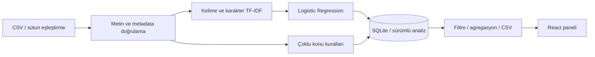

# Yorum Radar

[](https://github.com/berkayozdmr21/yorum-radar/actions/workflows/ci.yml)

### Müşterinin sesini duy. Yorumları içgörüye dönüştür.

Türkçe müşteri yorumlarını **duygu, konu ve zaman** açısından analiz eden, yerel çalışan bir makine öğrenmesi uygulaması. CSV dosyanızı yükleyin; olumlu, nötr ve olumsuz yorumları inceleyin, sık şikâyetleri görün ve sonuçları dışa aktarın.

**React · FastAPI · scikit-learn · SQLite · Docker**

> Uygulamanın tüm ana özellikleri API anahtarı olmadan çalışır. Başlangıç modeli sentetik örneklerle eğitilmiştir; bir üretim doğruluk iddiası taşımaz. Kendi etiketli verinizle yeniden eğitim desteklenir.

## Neler yapar?

| Özellik | Nasıl çalışır? |
|---|---|
| CSV içe aktarma | Sütun önizlemesi ve yorum/tarih/puan eşleştirme; UTF-8 ve Windows-1254; virgül, noktalı virgül veya sekme ayracı |
| Duygu analizi | Eğitilmiş TF-IDF + Logistic Regression ile üç sınıf tahmini |
| Konu analizi | Kargo, ürün kalitesi, fiyat, destek, iade, uygulama; açıklanabilir çoklu anahtar kelime kuralları |
| Analiz paneli | Günlük duygu grafiği, dağılım, olumsuz yorum oranı, puan ortalaması ve konu sıralaması |
| Yorum kütüphanesi | Veri seti, duygu, konu, tarih ve metin filtreleri; sayfalama; yorum detayları |
| Analiz laboratuvarı | Tek yorum tahmini, sınıf skorları, etkili kelimeler ve çıkarım süresi |
| Model değerlendirme | Logistic Regression / Naive Bayes karşılaştırması, sınıf bazlı metrikler, karışıklık matrisi, hata örnekleri |
| Dışa aktarma | Aktif filtrelere uyan yorumları UTF-8 BOM CSV olarak indirme; formül enjeksiyonuna karşı hücre koruması |
| Yerel depolama | Veri setleri ve analizler SQLite içinde saklanır; veri seti silinebilir |

## En kolay başlangıç: Windows

1. ZIP dosyasını bir klasöre çıkarın.
2. **`BASLAT.cmd`** dosyasına çift tıklayın. Python 3.10+ kurulu olmalı.
3. İlk çalıştırmada Python bağımlılıkları kurulur ve yerel model hazırlanır.
4. Başlatıcı boş bir port seçer, sunucudan yanıt aldıktan sonra tarayıcıyı açar.
5. **Örnek veriyi aç** düğmesiyle başlayın veya CSV yükleyin.

Terminal açık kalmalıdır. Durdurmak için Ctrl+C. Hatalar `baslatma.log` dosyasına yazılır. Teslim edilen ZIP derlenmiş arayüzü içerir; bu paket için Node.js kurulumu gerekmez. Git kaynak kodundan çalıştırırsanız frontend build yoksa başlatıcı Node.js/npm ile arayüzü derler.

**İlk bağımlılık kurulumu internet gerektirir.** Sonraki model çıkarımı çevrimdışı çalışır. Fontlar için isteğe bağlı Google Fonts isteği yapılır; erişim yoksa sistem fontu kullanılır. Yorum metinleri dış servise gönderilmez.

## Manuel kurulum

Gereksinimler: Python 3.10+, Node.js 22+ (kaynak kodu frontend build için).

```sh
git clone https://github.com/berkayozdmr21/yorum-radar.git
cd yorum-radar
```

```powershell
python -m venv .venv
.\.venv\Scripts\Activate.ps1
python -m pip install -r requirements.txt
cd frontend
npm ci
npm run build
cd ..
python run.py
```

macOS/Linux: aktivasyon için `source .venv/bin/activate` kullanın.

### Geliştirme modu

İki terminalde:

```sh
# Backend
python -m uvicorn backend.main:app --host 127.0.0.1 --port 8940
```

```sh
# Frontend
cd frontend
npm ci
npm run dev
```

Vite terminalde arayüz adresini gösterir. `/api` istekleri 8940 portuna yönlendirilir. API dokümantasyonu: http://127.0.0.1:8940/docs. Kaynakları değiştirdikten sonra normal başlatıcıyı kullanacaksanız `npm run build` ile derlemeyi yenileyin.

### Docker

```sh
docker compose up --build
```

Adres: http://127.0.0.1:8940. Yorumlar ve model dosyaları ayrı Docker volume’larında saklanır. Başka uygulama bu portu kullanıyorsa Compose içindeki dış portu değiştirin.

## CSV biçimi

```csv
yorum,tarih,puan
"Kargo çok hızlı geldi, teşekkürler.",2026-10-01,5
"Ürün bozuk geldi ve iade süreci uzadı.",2026-10-02,1
"Ürünü henüz denemedim.",2026-10-03,3
```

Yalnızca yorum sütunu zorunludur; adı farklı olabilir, yüklemede seçilir. Tarih `YYYY-MM-DD`, puan 1–5 olmalıdır. Boş yorumlar atlanır. Geçersiz tarih ve puan hücreleri boş bırakılır; sayıları yükleme sonucunda bildirilir. Tarihsiz yorumlar duygu toplamına dahildir, zaman grafiğine dahil değildir. Puan tahmin için kullanılmaz; model yalnızca metni okur.

Limitler: **5 MB, yükleme başına 5.000 satır, yorum başına 3.000 karakter, yerel kütüphanede toplam 50.000 yorum**. Satırlar otomatik tekilleştirilmez; aynı dosyayı iki kere içeri aktarırsanız iki veri seti oluşur. Örnek veri düğmesi aynı örnek seti tekrar oluşturmaz.

## Model nasıl çalışır?



- Türkçe I/İ dönüşümü ve boşluk normalizasyonu.
- Kelime 1–2 gramları + kelime sınırında karakter 3–5 gramları.
- Sınıf ağırlıkları dengelenmiş, sabit seed ile eğitilen Logistic Regression.
- Aynı eğitim/test verisinde Multinomial Naive Bayes baseline karşılaştırması.
- Model olasılıkları **kalibre edilmiş doğruluk olasılığı değildir**. `%55` inceleme eşiği bir ürün varsayımıdır; gerçek verinizle kalibre edilmelidir.
- Laboratuvardaki etkili kelimeler, seçilen sınıfın kelime özellikleri için TF-IDF × model katsayısı katkılarıdır. Karakter özelliklerini ve tüm sınıf karşılaştırmasını kapsamadığından tam bir nedensel açıklama değildir.
- Konu çıkarımı ayrı bir **kural sistemi**dir; eğitilmiş konu sınıflandırıcısı değildir. Bir yorum birden çok konuya girebilir. Konu toplamları yorum sayısından büyük olabilir.
- Radar notları sayımlardan üretilir; üretken AI özeti değildir. Olumsuz yorumlardaki kelimeler, yorum başına tek sayımla sıralanır.

## Gerçek model eğitimi ve değerlendirme

Etiketli verinizin `text,label` sütunları olmalı. Etiketler `positive`, `negative`, `neutral`; Türkçe `olumlu`, `olumsuz`, `nötr` de kabul edilir.

```sh
python -m ml.train --csv datasets/train.csv --test-csv datasets/holdout.csv
```

Kendi verinizle:

```sh
python -m ml.train --csv kendi_egitimim.csv --test-csv kendi_testim.csv
```

Ayrı test CSV verilmezse tekilleştirme sonrası sabit seed ile stratified %75/%25 ayrımı yapılır. Her sınıfta en az 5 farklı eğitim örneği gerekir. Aynı normalize metnin eğitim/test kesişimi veya çelişen etiketi varsa işlem durdurulur. Yakın anlamlı kopyaların otomatik tespiti yoktur; veri ayrımını ayrıca inceleyin.

Çıktılar:

- `artifacts/model.joblib`: model ve raporu içeren yerel bundle.
- `artifacts/report.json`: macro-F1, accuracy, sınıf bazlı precision/recall/F1, confusion matrix ve hatalı örnekler.
- Model sayfası çalışan sürecin raporunu gösterir.

Eğitimden sonra sunucuyu yeniden başlatın. Sonraki yüklemeler yeni modeli kullanır. Eski yorumların tahminleri, analiz sırasında kullanılan modelin eğitim zamanıyla birlikte korunur; yeniden tahmin için veri setini tekrar içe aktarın. Dışarıdan alınmış güvenilmeyen `joblib` dosyalarını yüklemeyin.

### Başlangıç değerlendirmesi

| Model | Macro-F1 | Accuracy |
|---|---:|---:|
| Logistic Regression | 0.945 | 0.944 |
| Multinomial Naive Bayes | 0.918 | 0.917 |

**Bu sonuçlar yalnızca 36 sentetik test örneğine aittir.** 120 eğitim örneği ve 36 test örneği elle yazılmıştır, gerçek müşteri yorumu değildir. Aynı yazar ve benzer dil yapıları değerlendirmeyi kolaylaştırabilir. Gerçek kullanım başarısı veya CV’de gerçek müşteri doğruluğu olarak sunulmamalıdır. Kaynak ve sınırlamalar: [datasets/README.md](datasets/README.md), [MODEL_CARD.md](MODEL_CARD.md). Paket içindeki rapor: [ml/baseline_report.json](ml/baseline_report.json).

### İsteğe bağlı transformer deneyi

API anahtarı gerektirmeyen bir BERTurk fine-tuning betiği de vardır. İlk kullanımda model indirilir; GPU önerilir. Bu deney normal kuruluma dahil değildir ve panelin aktif Logistic Regression modelini değiştirmez.

```sh
pip install -r requirements-transformer.txt
python -m ml.train_transformer --csv kendi_egitimim.csv --test-csv kendi_testim.csv --epochs 3
```

Temel model: [dbmdz/bert-base-turkish-cased](https://huggingface.co/dbmdz/bert-base-turkish-cased). Sonuç `artifacts/transformer/comparison.json`, ağırlıklar `artifacts/transformer/model/` altında oluşur. Aynı veriyle klasik baseline’lar da eğitilip karşılaştırma raporuna eklenir. Test kümesi epoch veya checkpoint seçimi için kullanılmaz. **Bu ortamda büyük transformer indirme/eğitimi çalıştırılmadı; transformer için başarı sonucu iddia edilmez.**

## API

| Method | Endpoint | Açıklama |
|---|---|---|
| GET | `/api/health` | Servis ve model durumu |
| GET | `/api/model` | Aktif modelin değerlendirme raporu |
| GET | `/api/datasets` | Kalıcı veri setleri |
| POST | `/api/preview` | Multipart CSV sütun ve satır önizlemesi |
| POST | `/api/import` | CSV + text_column/date_column/rating_column eşleştirmesi |
| POST | `/api/demo` | Sentetik örnek veri seti |
| GET | `/api/sample` | Örnek CSV indirme |
| DELETE | `/api/datasets/{id}` | Veri setini ve yorumlarını silme |
| POST | `/api/predict` | `{ "text": "Yorum metni" }` tek yorum tahmini |
| GET | `/api/dashboard` | Filtrelenmiş istatistik ve sayfalı yorumlar |
| GET | `/api/export` | Aynı filtrelerle CSV dışa aktarma |

Dashboard/export filtreleri: `dataset_id`, `sentiment`, `topic`, `q`, `date_from`, `date_to`. Dashboard ayrıca `page`, `page_size` kabul eder. Metin araması SQLite LIKE ile yapılır; Türkçe büyük/küçük harf eşleştirmesi SQLite sınırlarına tabidir. Dosya, metadata ve filtre parametreleri doğrulanır; SQL sorguları parametrelidir.

## Testler

```sh
python -m unittest discover -s tests -v
cd frontend
npm ci
npm test
npm run build
```

16 Python testi; CSV kodlama/ayraç, eşleştirme, veri limitleri, tahmin, filtreleme, agregasyon, sayfalama, silme, dışa aktarma, veri sızıntısı ve eğitim doğrulamaları. 6 React testi; boş panel, CSV yükleme/eşleştirme, analiz laboratuvarı, filtre/export bağlantısı, hata bildirimi ve Escape ile modal kapatma.

Arayüz testleri jsdom üzerinde API taklitleriyle çalışır; backend testleri gerçek eğitilmiş başlangıç modelini kullanır. GitHub Actions build, frontend/backend testleri ve baseline eğitimini çalıştırır. Kontrol edilenler ve sınırlar: [VERIFICATION.md](VERIFICATION.md).

## Proje yapısı

```text
backend/              REST API, CSV işleme, SQLite, konu kuralları
ml/                   Eğitim, çıkarım, değerlendirme, transformer deneyi
datasets/             Sentetik eğitim/test/demo CSV ve veri kaynağı notları
frontend/src/         React paneli ve etkileşim testleri
tests/                API ve eğitim testleri
run.py                Boş port + health check + tarayıcı başlatma
BASLAT.cmd            Windows kurulum ve başlatma
Dockerfile            React build + Python backend
.github/workflows/    Otomatik doğrulama
```

## Sınırlar ve geliştirme alanları

Bu sürüm tek kullanıcılı yerel portföy uygulamasıdır. İnternete açık paylaşımlı kullanım için kimlik doğrulama, kullanıcı bazlı veri ayrımı, hız limiti ve izleme eklenmelidir. Sentetik model ironi, alan değişimi, karma duygu ve uzun yorumlarda yanılabilir. Konu kuralları ekler ve eş anlamlılar nedeniyle konu kaçırabilir veya fazla etiket verebilir.

Sonraki adımlar: bağımsız gerçek test seti, veri kaynağı bazlı ayrım, olasılık kalibrasyonu, eğitilmiş çok etiketli konu modeli, transformer serving ve insan düzeltmelerinin ayrı eğitim havuzuna alınması.

## Geliştirici

[Berkay Özdemir](https://github.com/berkayozdmr21)
